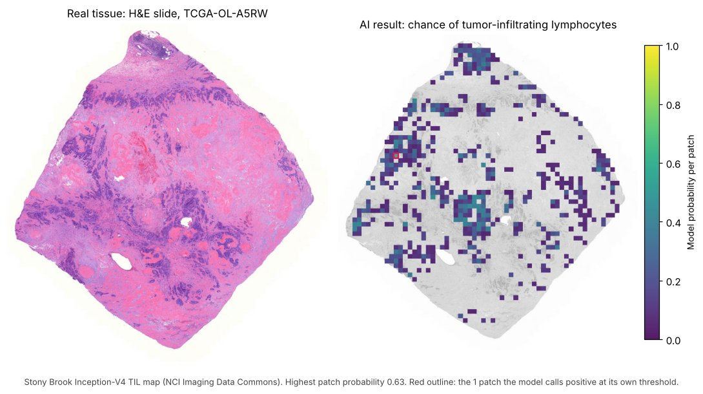

# Multimodal Case Room

**OncoSys Cancer AI Lab Hackathon · Track: Evidence Navigator · Product: [Multimodal Case Room](products/multimodal-case-room.md)**

> 🎥 **Demo video:** _TODO: add link_

## Who it's for and what they finish

**User:** a cancer research analyst reviewing one TCGA breast cancer (TCGA-BRCA) tumour sample.

**Workflow:** look up a sample by its barcode, open its case page, and see every data layer that matches that exact barcode. That covers clinical, survival, protein (RPPA), mutation, copy number, RNA and pathology slides, with links to the slides in the NCI viewer. Next, review the 10 automatic quality checks and any conflicting records, read the gaps listed under *Limitations and missing evidence*, and **export a source-cited case brief** (Markdown) for a person to review. If they want, the analyst can also ask Claude questions about the case. Every answer cites evidence IDs that point back to source files.

Records are attached only when the barcode matches exactly. Missing data is shown as missing, never filled in.

## Demo story: problem → user → decision → outcome

**Problem.** A TCGA case is spread across seven sources: a clinical table, a survival table, four molecular matrices, and slide images held in a separate archive. Sample, patient and slide IDs look almost the same (`TCGA-BH-A8FY`, `TCGA-BH-A8FY-01`, `TCGA-BH-A8FY-01A-01-TSA`). A reviewer who joins them by hand can attach the wrong slide, fail to notice a missing layer, or overlook two sources that disagree. The study then quietly inherits the mistake.

**User.** A cancer research analyst preparing breast cancer cases for a study. They are reviewing one case under time pressure.

**Decision.** *Can I use this case as it is, use it with caveats, or does a person need to check it first? If so, what exactly should they check?*

**Outcome.** The analyst decides in minutes, not by searching files. They leave with a downloadable case brief in which every statement cites its file, row or slide, ready to hand to a reviewer.

### Walkthrough (about 3 minutes, using the practice cases in `products/multimodal-case-room/practice_cases.csv`)

| Step | Case | What the analyst sees | What they decide |
|---|---|---|---|
| 1. Clean case | **C1** `TCGA-A7-A3RF-01` | All 6 data layers, a diagnostic and a frozen slide (each opens in the NCI viewer), 10/10 quality checks passed, no conflicts. Clinical ER+/PR+/HER2− shown next to the RPPA protein values. | **Use it.** Download the brief. Every line traces to `clinical.tsv` row 159, a protein column, or a slide barcode. |
| 2. Ambiguous evidence | **C4** `TCGA-BH-A1FJ-01` | The biomarker table shows ER **clinically Negative**, but its ER protein value (2.27) is higher than three cases recorded as clinically ER-positive (C3 1.35, C5 1.39, C6 1.57). HER2 clinical status is **Unavailable**. The app shows both values side by side and doesn't pick one. | **Needs human review.** Check the clinical ER test against the protein measurement before relying on ER status. The analyst can ask Claude *"Do any records disagree?"*, and the answer cites evidence IDs. |
| 3. Missing evidence | **C7** `TCGA-BH-A8FY-01` | The quality-check warnings and *Limitations and missing evidence* show **no protein data** and **frozen slides only, no diagnostic slide**. | **Use with caveats.** Exclude it from any protein or diagnostic-slide analysis. Record the gap in the brief. |
| 4. Refuses a bad link | **C8** `TCGA-A7-A56D-11` | A normal-tissue record with a slide but **no clinical or molecular record**. The app marks it *Slide-only* and **won't attach the same patient's tumour sample (`TCGA-A7-A56D-01`)**. | **Don't use for case-level analysis.** The app shows the gap instead of filling it. |
| 5. Hand off | any | *Download Case Brief (.md)*. The brief keeps the sources, slide links, quality checks, conflicts and the human-review note. | The reviewer gets the same evidence the analyst saw. |

**What the demo shows the judges:** a result they can verify (C1, traced to row and column), a limitation they can see in the product (C7, C8), evidence that disagrees and is shown rather than smoothed over (C4), and no diagnosis, treatment advice or risk score at any point.

## Team

| Name | Role |
|---|---|
| _TODO_ | _TODO_ |
| _TODO_ | _TODO_ |
| _TODO_ | _TODO_ |

## Setup and run

Needs Python 3.10+ and about 75 MB of disk for the data. On macOS/Linux use `python3` if `python` points to Python 2.

```bash
git clone https://github.com/BHIMASAIKAUSHIK/NEU-HACKATHON.git
cd NEU-HACKATHON
pip install -r requirements.txt

# Required: download the frozen TCGA-BRCA release and verify it against data/tcga-brca/sources.csv
python data/tcga-brca/fetch.py

# Optional: run the test suite
python -m unittest discover -s tests -v

# Start the app
streamlit run app.py
```

Open http://localhost:8501.

> ⚠️ Run `fetch.py` before you start the app. Without it the sample list still loads, but the case pages show clinical and molecular layers as unavailable.

**Optional, Claude Q&A:** paste your own Claude API key in the sidebar. The key stays in the browser session and is never written to disk or committed. Everything else works without a key.

**Judge case:** on the start page, open *Open the judge-selected case* and upload `case_room_case.txt` from the envelope.

## One result you can verify

Open **`TCGA-A7-A3RF-01`**. The case page and the exported brief show:

| Shown in app | Source file | How to reproduce |
|---|---|---|
| ER Positive, PR Positive, HER2 Negative, Stage IIA | `data/tcga-brca/raw/clinical.tsv`, row 159 (`sampleID == TCGA-A7-A3RF-01`) | open the file at that row |
| RPPA ER-alpha 3.67, PR 0.2949, HER2 −1.2124 | `data/tcga-brca/raw/protein_rppa.tsv.gz`, column `TCGA-A7-A3RF-01`, rows `ERALPHA`, `PR`, `HER2` | see the snippet below |
| 2 slides: `TCGA-A7-A3RF-01Z-00-DX1` (diagnostic FFPE) and `-01A-01-TS1` (frozen), each with an NCI viewer link | `data/tcga-brca/slide_manifest.csv`, where `sample_id == TCGA-A7-A3RF-01` | filter the CSV |
| 10/10 quality checks pass | logic in `src/case_loader.py` (`run_case_quality_checks`) | `python -m unittest tests.test_case_loader` |

```python
import pandas as pd
df = pd.read_csv("data/tcga-brca/raw/protein_rppa.tsv.gz", sep="\t", index_col="Sample_description")
print(df.loc[["ERALPHA", "PR", "HER2"], "TCGA-A7-A3RF-01"])
```

Input files are checked against the SHA-256 checksums in `data/tcga-brca/sources.csv` (frozen release, retrieved 2026-11-10).

## One limitation you can inspect

Open **`TCGA-BH-A8FY-01`**. The app flags that this tumour has **no protein (RPPA) data and only a frozen slide, with no diagnostic FFPE slide**. You can see this in the quality-check warnings and the *Limitations and missing evidence* section. **`TCGA-A7-A56D-11`** is a normal-tissue record that has a slide but no clinical or molecular data, and the app marks it as *Slide-only*.

Other limits by design: the app reports recorded values only and does not interpret slide images. Receptor statuses are shown as recorded, with no threshold applied to the RPPA values. Quality checks only cover consistency and coverage, so they can't tell you whether a measurement is correct.

## Human review and scope

- Every case page carries this banner: *Research-use prototype … not a diagnosis, treatment recommendation, risk score, or claim of clinical validity.*
- Conflicting records are kept side by side and labelled **"require human review"**. The exported brief closes by telling the reader to check the original evidence with a qualified human reviewer.
- Claude's instructions forbid diagnosis, treatment advice, outcome prediction and slide interpretation. If the evidence doesn't answer a question, it must say so.

## Data

Only the frozen **TCGA-BRCA** release provided for the event (UCSC Xena TCGA hub plus NCI Imaging Data Commons slide links). Sources, checksums and licences are in [`data/tcga-brca/sources.csv`](data/tcga-brca/sources.csv) and [`DATA_LICENSES.md`](DATA_LICENSES.md). We added no other data.

## Third-party code and licences

| Package / service | Used for | Licence |
|---|---|---|
| [Streamlit](https://github.com/streamlit/streamlit) | Web app | Apache-2.0 |
| [pandas](https://github.com/pandas-dev/pandas) | Data loading and joins | BSD-3-Clause |
| [NumPy](https://github.com/numpy/numpy) | pandas dependency | BSD-3-Clause |
| [matplotlib](https://github.com/matplotlib/matplotlib) | Starter notebook plots | Matplotlib License (PSF-based) |
| [Jupyter](https://github.com/jupyter/notebook) | Starter notebook | BSD-3-Clause |
| [jsonschema](https://github.com/python-jsonschema/jsonschema) | Shared findings format validator | MIT |
| [Pillow](https://github.com/python-pillow/Pillow) | Image packs (starter) | MIT-CMU (HPND) |
| [scikit-learn](https://github.com/scikit-learn/scikit-learn) | Image packs (starter) | BSD-3-Clause |
| [idc-index](https://github.com/ImagingDataCommons/idc-index) | IDC slide manifests | MIT |
| [cryptography](https://github.com/pyca/cryptography) | Opening the sealed envelopes | Apache-2.0 OR BSD-3-Clause |
| [Claude API](https://docs.claude.com) (Anthropic) | Optional case Q&A, called over HTTPS with the user's own key | Anthropic commercial terms |
| Hackathon starter repo (OncoSys challenge) | Data packs, fetch scripts, starter, format | See [`RULES.md`](RULES.md) / [`DATA_LICENSES.md`](DATA_LICENSES.md) |

More detail: [`PROJECT_STATUS.md`](PROJECT_STATUS.md) · [`TEAM_HANDOFF.md`](TEAM_HANDOFF.md)

---

# Hackathon challenge brief (from the organizers)



**Left:** a real H&E slide from TCGA (patient TCGA-OL-A5RW). **Right:** a published AI model's estimate of where tumor-infiltrating lymphocytes are. Its highest patch probability is 0.63, and at its own threshold it calls just one patch positive. **Is that result right, and how would anyone check?** That's what you'll build tools for.

<p>
<a href="data/README.md"></a>
<a href="products/README.md"></a>
<a href="https://colab.research.google.com/github/disleveK/oncosys-hackathon-challenge/blob/main/starter/tcga_starter.ipynb"></a>
</p>

You don’t need a GitHub account to open the starter. You’ll need to sign in to Google to run it in Colab. No Google account? [Run it on your computer](#run-it-on-your-computer).

- **Explore the data:** seven data packs (tumor molecular data, tissue images, CT scans, cell lines, trial records) plus a 30-minute warm-up. The menu shows included starters, source downloads and viewer links.
- **Pick a mission:** six featured products and optional custom builds, across two tracks.
- **Run the starter:** in 15 minutes, download real tumor data, see how each join shrinks the cohort, and open a slide in your browser.

## Pick a user, build one workflow
| Track | What it does | Featured products |
|---|---|---|
| **Cohort Firewall** | Catches what could make a result unreliable | [Cohort Control Tower](products/cohort-control-tower.md) · [Cohort Studio](products/cohort-studio.md) |
| **Evidence Navigator** | Helps someone investigate a result and decide what to do | [Multimodal Case Room](products/multimodal-case-room.md) · [Evidence Copilot](products/evidence-copilot.md) · [Research Claim Auditor](products/research-claim-auditor.md) · [Repair Review Desk](products/repair-review-desk.md) |

Build a web app, an AI agent, a visual workflow, or a tool that plugs into a notebook. You can also combine two products or [pitch your own](products/README.md#pitch-your-own-lighter-support).

**The bar:** a judge can use your workflow without you narrating, and it shows **one result they can verify** and **one limitation they can inspect.**

**The finale:** a Cohort Control Tower catches a silent change in a new data release, and a different team's Repair Review Desk receives the findings and makes the review decision, live, through the [shared format](format/README.md).

## The week
| When | What |
|---|---|
| **Wed, Nov 11, 7 PM ET** | Virtual kickoff. Form your team, pick a product, run the starter. [Slides (PDF)](kickoff/Cancer_AI_Lab_Kickoff.pdf) · [recording](https://the-open-accelerator.com/hackathon/upcoming/OncoSysHack/) |
| **Thu, Nov 12, 1:30 PM ET** | Team registration closes ([form](https://red.ht/toa-oncosys-team-matching), teams of 3–5). Organizers then post **team pairs** in Discord. |
| **Thu, Nov 12 · Checkpoint 1** | Post **one working result** in Discord: a screenshot or short clip of your tool producing something real from the data. |
| **Fri, Nov 13 · Checkpoint 2** | **Swap repos with your paired team.** Each team clones the other's repo into a fresh folder, follows its README alone, and posts in Discord what worked and what broke. |
| **Sat, Nov 14** | In person at the Cabral Center. You open your [sealed envelope](envelopes/README.md) at the start of your Q&A. Code freeze **2:15 PM**; demos 2:30–4:00 PM; awards 4:30 PM. |

Checkpoints aren't part of the rubric, but Checkpoint 2 is the best way to find out, before judges do, whether your project runs on someone else's machine.

## The data packs
| Pack | One record is… | Status |
|---|---|---|
| [TCGA breast cancer](data/tcga-brca/README.md) *(core)* | A tumor sample with clinical, survival, mutation, copy number, RNA and protein data, plus slide links | Ready |
| [Pathology: PathMNIST](data/pathmnist/README.md) | A labelled colorectal tissue patch | Ready |
| [Molecular + imaging: CPTAC](data/cptac/README.md) | A lung, colon or kidney cancer case | Ready: protein, slides and CT links |
| [Imaging: LIDC-IDRI](data/lidc-idri/README.md) | A chest CT with radiologists' nodule marks | Ready |
| [Prediction: DepMap](data/depmap/README.md) | A cancer cell line | Ready |
| [Trial records: ClinicalTrials.gov](data/clinical-trials/README.md) | A dated trial record + fictional cases | Ready for practice |
| [Advanced: CAMELYON17](data/camelyon17/README.md) | A lymph-node slide from one of 5 hospitals | Ready (source-linked) |

**Only join records where a documented match exists.** Tissue patches, cell lines, tumor samples and CT scans describe different things. See [the joining rule](data/README.md#the-joining-rule).

## What's in this repo
| Path | What it is |
|---|---|
| `starter/tcga_starter.ipynb` | The 15-minute starter |
| `products/` | Six featured product briefs, practice inputs, and pitch-your-own ideas |
| `data/` | Seven data packs: each with a README, sources and checksums, fetch script, and manifests |
| `kickoff/` | Kickoff slides (PDF) |
| `assets/` | The challenge page image |
| `envelopes/` | Sealed envelopes: the unseen inputs for Saturday, plus a practice envelope ([how they work](envelopes/README.md)) |
| `format/` | Shared findings format v0.2, validator and reference output |
| `warmup/wisconsin/` | Optional 30-minute warm-up on a small dataset |
| [`RULES.md`](RULES.md) · [`DATA_LICENSES.md`](DATA_LICENSES.md) | What's allowed, and how to credit the data |
| [`SUBMISSION_CHECKLIST.md`](SUBMISSION_CHECKLIST.md) | What to check before the code freeze |

## Run it on your computer
The local Jupyter route needs no Google account, and no GitHub account is needed to clone this public repo.

```bash
git clone https://github.com/disleveK/oncosys-hackathon-challenge.git
```
```bash
cd oncosys-hackathon-challenge
```
```bash
pip install -r requirements.txt
```
```bash
python data/tcga-brca/fetch.py
```
```bash
jupyter notebook starter/tcga_starter.ipynb
```

## Recommended tools
Use any stack. Start with the smallest toolset that lets someone else rerun your work. No paid account, hosted app, or AI coding assistant is required.

| Task | Optional tools | What to practice |
|---|---|---|
| Read and check the data | [pandas](https://pandas.pydata.org/), [Polars](https://docs.pola.rs/), or [DuckDB](https://duckdb.org/). For repeatable checks, try [Pandera](https://pandera.readthedocs.io/) or [Great Expectations](https://docs.greatexpectations.io/). [ydata-profiling](https://docs.profiling.ydata.ai/) can help with initial exploration. | Keep sample and patient IDs separate. Record the release, checksums, checks run, and affected samples. Treat a profile report as a starting point, not a verdict. |
| Compare figures | A notebook or SQL is enough. | Compare figures with their denominators. Test whether reasonable choices about which samples to include change the conclusion. |
| Work with slides | NCI Imaging Data Commons viewer links in `slide_manifest.csv`; [`idc-index`](https://pypi.org/project/idc-index/) to download | Distinguish diagnostic from frozen slides. Link a slide to a case only when its barcode matches. |
| Build a reviewer interface | [Streamlit](https://docs.streamlit.io/get-started) or [Gradio](https://www.gradio.app/docs). Try [axe-core](https://github.com/dequelabs/axe-core) or [Lighthouse](https://developer.chrome.com/docs/lighthouse/) for accessibility checks. | Make it possible to trace a headline number to its evidence and reach a decision without the presenter. Test keyboard navigation and whether labels make sense without color. |
| Use AI responsibly | Any LLM or a local model. Users supply their own key; never commit one. | Let the AI run real queries rather than answer from memory. Show its sources. Make it say when the data can't answer. |
| Document provenance | The [shared format](format/README.md), a Markdown evidence log, or [W3C PROV](https://www.w3.org/TR/prov-overview/) as background | For each claim, record the release, samples, calculation, limitation, and who should review it. |
| Check for secrets | [Gitleaks](https://github.com/gitleaks/gitleaks), manually or in pre-commit | Before submitting, check for credentials, tokens, private URLs and restricted files. |

## Source and citation
TCGA data from the UCSC Xena TCGA hub and NCI Imaging Data Commons; full credits in [`DATA_LICENSES.md`](DATA_LICENSES.md). The data is de-identified but patient-derived: research use only, no re-identification, no clinical claims.
